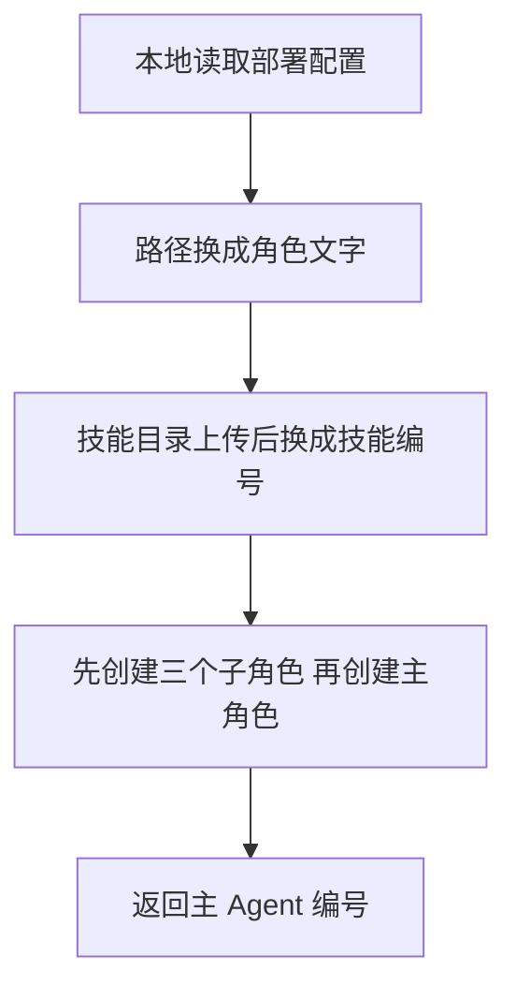

# 从角色文件到云端配置

你想弄清的是：`system.file` 为什么写一个文件路径，最后云平台却收到了提示词文字？

本例固定源码版本为 `574ed3624aebd0418c7e96cd101262f30210ab26`，只讲对账角色的部署准备。**做事情的是本地部署脚本；部署结束尚未开始对账。**

## 先认识两份文件

`managed-agent-cookbooks/gl-reconciler/agent.yaml` 是本地脚本读取的部署配置。`plugins/agent-plugins/gl-reconciler/agents/gl-reconciler.md` 是给 Claude 阅读的角色说明，描述负责核对账目、追踪差异和起草报告。YAML 提供字段和引用关系，Markdown 提供实际文字；文件自己不会执行对账。

主配置中有：

```yaml
system:
  file: ../../plugins/agent-plugins/gl-reconciler/agents/gl-reconciler.md
  append: "You are running headless. Produce files in ./out/; do not assume an open Office document."
```

`file` 告诉脚本去哪里读角色说明。`../../` 以 `agent.yaml` 所在目录为基准。云平台不能凭这条路径访问用户电脑，因此本地脚本必须先把文件内容取出来。

## 这个字段怎样变化

从仓库根目录执行 `bash scripts/deploy-managed-agent.sh gl-reconciler` 后，脚本读取 YAML，替换环境变量，然后执行 `inline_system`。这个函数打开角色文件，取出全文，并追加 `append`。源码没有单独剥离 Markdown 文件头。

下面是转换示意，方括号代表为了阅读省略的完整文字：

```text
输入：system 是包含 file 与 append 的配置对象
输出：system 是一个字符串

"[角色文件全文，包括文件头]

You are running headless. Produce files in ./out/; do not assume an open Office document."
```

`headless` 在此提醒角色没有已打开的 Office 文档界面；应将产物写成执行工作目录下的 `./out/` 文件。它不是启动后台进程的命令。原 YAML 和 Markdown 没有被改写，变化发生在准备发送的请求内容中。

源码：[本地读取与替换函数](https://github.com/anthropics/financial-services/blob/574ed3624aebd0418c7e96cd101262f30210ab26/scripts/deploy-managed-agent.sh#L120-L136)。

## 其他路径也要换成平台能使用的引用

技能目录保存在本地。脚本将它们压缩上传到技能接口，再把返回的 `skill_id` 写入 Agent 配置。`skill_id` 是云平台给技能的编号，之后由平台用它找到技能包。

主 Agent 还引用三个子 Agent 的 YAML。脚本先创建这些子 Agent，取得各自的编号与版本，再提交主 Agent 配置。**创建子 Agent 资源时没有读取账目，创建主 Agent 资源时也没有起草报告。**



箭头表示本地部署程序的处理顺序。这张图的终点是配置创建结果；业务会话和任务提交在图外，不能把最后一个节点当成报告生成完成。

源码：[上传技能](https://github.com/anthropics/financial-services/blob/574ed3624aebd0418c7e96cd101262f30210ab26/scripts/deploy-managed-agent.sh#L60-L118)、[创建角色配置](https://github.com/anthropics/financial-services/blob/574ed3624aebd0418c7e96cd101262f30210ab26/scripts/deploy-managed-agent.sh#L138-L177)。

## 什么还没有发生

脚本打印主 Agent ID 后结束，没有创建会话或提交对账指令。需要另外由宿主或业务程序提交某个日期、账户和可访问材料，角色才会开始处理任务。

另外，脚本在发送前删除 `output_schema`。这个字段是输出格式的规则；部署脚本没有调用独立验证器，因此不能只凭配置中存在规则，就认为每次输出已经检查。

变化练习：部署后修改本地角色文件，会自动改变已创建的云端 Agent 吗？这个脚本没有持续同步，也没有更新已有资源的分支。需要另行更新配置；再次运行当前脚本仍是创建资源。

本例核对了本地源码、配置和引用；没有调用云端接口或执行金融任务。完整的技能内容、运行权限、真实输出和人工审核均不在本例的验证范围中。
